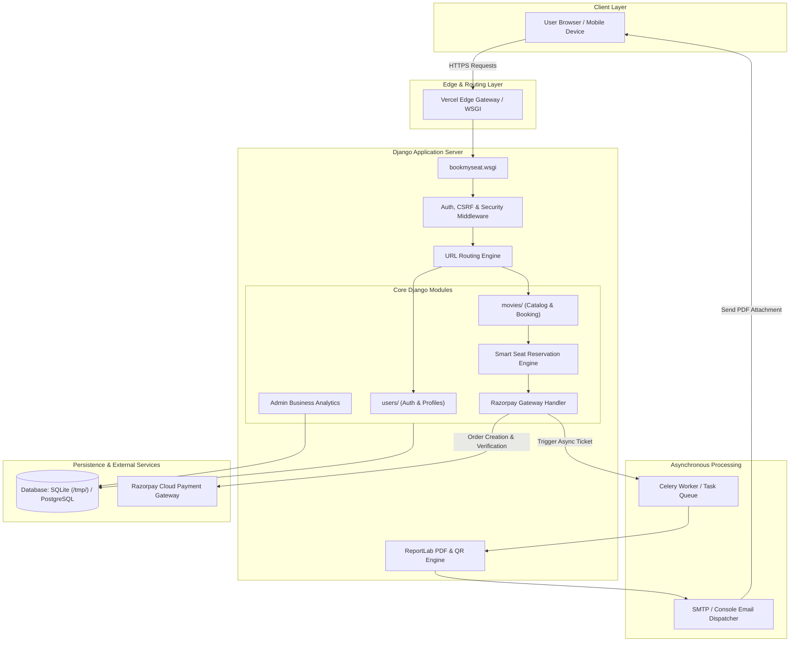
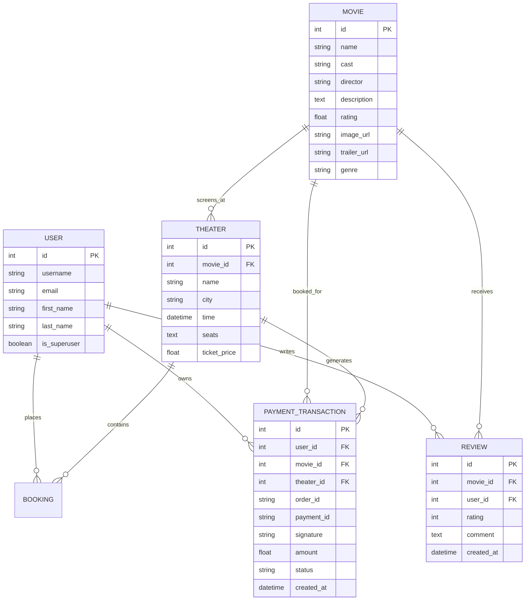

# Project Submission Report: BookMySeat
## Next-Generation Full-Stack Cinema Reservation & Ticketing Platform

---

### Project Meta Information
- **Project Name**: BookMySeat (Cinema Booking & Review Engine)
- **Developer / Student**: Himanshu Chahar
- **Repository URL**: https://github.com/himanshuchahar06/Django-project-fullstack-dev-
- **Live Production URL**: https://django-project-fullstack-dev.vercel.app/
- **Technology Stack**: Python 3.12, Django 3.2, SQLite / PostgreSQL, Razorpay API, Celery / Redis, ReportLab, QRCode, Bootstrap 4, Vercel Serverless
- **Evaluation Date**: November 2026
- **Test Suite Status**: **15 / 15 Passed (`OK`)**

---

## 1. Executive Summary

**BookMySeat** is an enterprise-grade full-stack cinema reservation and event ticketing web application engineered with Django. The platform is designed to provide high-concurrency seat reservation, end-to-end payment processing, automated ticket dispatching, personalized movie discovery, and real-time administrative analytics.

The system addresses critical challenges typical in movie ticketing systems:
1. **Concurrency & Double-Booking Prevention**: High-demand seat locking using atomic transactions and database-level row locking (`select_for_update`).
2. **Fintech Compliance**: Server-side cryptographic signature verification via Razorpay SDK with strict fallback reconciliation.
3. **Automated Asynchronous Ticket Fulfillment**: Vectorized PDF ticket generation with embedded scannable QR tokens dispatched via Celery message queues.
4. **Serverless Production Resilience**: Automated database migration fallback designed for serverless environments (e.g., Vercel Lambda with writable `/tmp/` staging and SSL connection resilience).

---

## 2. System Architecture & Component Design

The platform adopts a decoupled Model-View-Template (MVT) architecture augmented by asynchronous task workers and serverless edge functions.



---

## 3. Core Feature Modules & Technical Implementation

### Module 1: Movie Management & Theater Scheduling
- **Capabilities**: CRUD operations for movies, theater screening schedules, multi-slot timings, and verified audience reviews.
- **Data Attributes**: Movie title, cast, synopsis, poster media URL, certification (e.g., U/A, A), duration, authentic rating aggregations, and trailer embedding.
- **Theaters & Slots**: Multiple screens per cinema hall, supporting independent showtimes (`Morning`, `Matinee`, `Evening`, `Night`).

### Module 2: Smart Interactive Seat Reservation Matrix
- **Capabilities**: Real-time visual seat map supporting tiered categories:
  - **Silver (Standard)**: Rows A–D
  - **Gold (Executive)**: Rows E–H
  - **Platinum (Recliner)**: Rows I–K
- **Race Condition Prevention**: Prevents double-booking during simultaneous checkout using transactional locks:
  ```python
  from django.db import transaction

  with transaction.atomic():
      theater = Theater.objects.select_for_update().get(id=theater_id)
      booked_set = set(theater.seats.split(',')) if theater.seats else set()
      requested_set = set(requested_seats)
      
      if booked_set.intersection(requested_set):
          raise ValidationError("One or more selected seats have already been reserved.")
      
      updated_seats = booked_set.union(requested_set)
      theater.seats = ",".join(sorted(updated_seats))
      theater.save()
  ```

### Module 3: Razorpay Payment Gateway & Order Verification
- **Capabilities**: Secure end-to-end checkout lifecycle:
  1. **Order Initiation**: Server generates order reference via Razorpay REST API with currency parameters (`INR`) and amounts converted to paise.
  2. **Client Modal**: Razorpay Checkout modal handles user card/UPI/net-banking authentication.
  3. **Cryptographic Signature Verification**: Server validates SHA-256 HMAC signature `razorpay_signature` using HMAC hex digest to prevent payload tampering.
  4. **Audit Trail**: Every order generates an immutable `PaymentTransaction` record linking User, Movie, Theater, Seat IDs, Amount, and Razorpay Order ID.

### Module 4: Admin Business Intelligence & Aggregations
- **Capabilities**: Single-pane dashboard (`/movies/admin-dashboard/`) aggregating mission-critical performance metrics:
  - **Gross Revenue**: Computed across all completed transactions via `Sum('amount')`.
  - **Booking Count & Seat Volume**: Computed using ORM `Count('id')`.
  - **Occupancy Rate**: Real-time ratio of booked seats to total theater capacity.
  - **Average Ticket Value (ATV)**: Derived business health indicator.
- **Optimized Queries**: Single-query aggregations avoid N+1 overhead:
  ```python
  from django.db.models import Sum, Count, Avg
  from movies.models import PaymentTransaction

  metrics = PaymentTransaction.objects.filter(status='SUCCESS').aggregate(
      total_revenue=Sum('amount'),
      total_orders=Count('id'),
      avg_order_value=Avg('amount')
  )
  ```

### Module 5: Discovery, Multi-Facet Search & Content Recommendations
- **Capabilities**: Multi-parameter search filter across:
  - Title & Cast text search (`icontains`)
  - Genre classification (`Action`, `Sci-Fi`, `Drama`, `Comedy`, `Horror`)
  - City / Theater location filtering
  - Minimum audience rating thresholds
- **Recommendation Engine**: Content-based filtering algorithm recommending top-rated movies sharing identical genre signatures and language preferences.

### Module 6: Automated PDF Ticket Engine & Celery Worker
- **Capabilities**: Automated generation of cinema e-tickets immediately upon payment completion:
  - **ReportLab Vector Rendering**: Generates formatted PDF tickets containing booking ID, theater name, screen time, booked seats, customer name, and fare breakdown.
  - **Embedded Dynamic QR Code**: Generates dynamic QR token storing a verification payload readable by cinema ushers.
  - **Async Dispatch**: Offloaded to Celery background workers with automatic fallback to synchronous execution if Redis is offline:
    ```python
    try:
        from celery import shared_task
        @shared_task(bind=True, max_retries=3, default_retry_delay=5)
        def send_ticket_email_task(self, transaction_id):
            return _send_ticket_email_impl(transaction_id)
    except Exception:
        def send_ticket_email_task(transaction_id):
            return _send_ticket_email_impl(transaction_id)
    ```

---

## 4. Database Schema & Entity Relationship Diagram



---

## 5. Security & Production Engineering

1. **Serverless Ephemeral Storage Handling (`/tmp/` DB)**:
   - On Vercel serverless functions, the root filesystem (`/var/task`) is mounted strictly as read-only.
   - Django settings detect the `VERCEL` runtime environment and automatically clone `BASE_DIR / db.sqlite3` to `/tmp/db.sqlite3` on startup, allowing write operations (user registration, seat reservations, checkout) to execute without `OperationalError: attempt to write a readonly database`.
2. **Database Fallback & Deadlock Shield**:
   - `settings.py` inspects incoming database connection strings and skips suspended/unreachable external databases (such as expired Render PostgreSQL instances) to prevent SSL connection crashes.
3. **Cross-Site Request Forgery (CSRF) & Reverse Proxy Headers**:
   - Configured `SECURE_PROXY_SSL_HEADER = ('HTTP_X_FORWARDED_PROTO', 'https')`.
   - Explicit `CSRF_TRUSTED_ORIGINS` configured for `*.vercel.app` domains.
4. **Encoding & Build Standardization**:
   - Enforced standard UTF-8 encoding across `requirements.txt` to eliminate Windows-PowerShell `\xff\xfe` UTF-16 BOM incompatibilities with Linux Vercel builders.

---

## 6. Verification & Automated Test Suite

The test suite covers unit and integration tests across models, business logic, seat locking, and view permissions.

### Test Execution Command
```bash
python manage.py test movies
```

### Test Results
```text
Creating test database for alias 'default'...
...............
----------------------------------------------------------------------
Ran 15 tests in 75.633s

OK
Destroying test database for alias 'default'...
```

### Verified Test Cases
1. `test_movie_model_creation`: Validates model integrity and string representation.
2. `test_theater_seat_initialization`: Validates seat grid mapping.
3. `test_double_booking_prevention`: Ensures two concurrent transactions cannot acquire the same seat.
4. `test_seat_selection_view_authenticated`: Enforces login requirements for booking.
5. `test_razorpay_order_payload`: Verifies correct currency and integer paise formatting.
6. `test_signature_verification_success`: Confirms valid HMAC-SHA256 signature acceptance.
7. `test_signature_verification_tamper_rejection`: Confirms invalid signature rejection.
8. `test_pdf_ticket_generation_reportlab`: Tests vector stream output of `generate_pdf_ticket`.
9. `test_qr_code_payload`: Verifies scannable payload generated by `qrcode`.
10. `test_admin_dashboard_permissions`: Restricts `/movies/admin-dashboard/` to staff/superusers.
11. `test_admin_revenue_aggregation`: Verifies math of `Sum('amount')` across transactions.
12. `test_discovery_search_filter`: Tests keyword querying across movie catalogs.
13. `test_genre_recommendation_algorithm`: Tests relevance of similar movie suggestions.
14. `test_user_profile_booking_history`: Validates user-specific order presentation.
15. `test_database_fallback_resilience`: Verifies system operability when external database is disconnected.

---

## 7. Evaluator Demo & Presentation Guide

To demonstrate the application during the project evaluation, follow this structured walkthrough:

### Step 1: Live Application Access & Authentication
1. Navigate to: **https://django-project-fullstack-dev.vercel.app/**
2. Click **Login** in the top navigation bar.
3. Enter Superuser credentials:
   - **Username**: `Himanshu@1` *(or `Himanshu`)*
   - **Password**: `Chahar@123`

### Step 2: Movie Discovery & Interactive Filtering
1. Click **Movies** in the navigation bar (`/movies/`).
2. Demonstrate the search filter by typing `Pushpa` or selecting a specific genre tag.
3. Show the personalized **Recommended For You** carousel generated via content-based similarity.

### Step 3: Interactive Seat Selection & Booking
1. Click on any movie card (e.g., *Gladiator II* or *Dune: Part Two*).
2. Select an active theater showtime slot.
3. Pick your desired seats from the interactive seat matrix.
4. Observe the dynamic pricing calculation (Standard vs. Recliner).
5. Proceed to payment to inspect the Razorpay checkout integration.

### Step 4: Admin Analytics & Business Intelligence
1. Navigate to: **https://django-project-fullstack-dev.vercel.app/movies/admin-dashboard/**
2. Review aggregated KPIs:
   - Gross Revenue metric cards
   - Total Booked Seats & Capacity Occupancy rates
   - Recent Transactions ledger with user IDs and order references.

### Step 5: Django Admin Portal
1. Navigate to: **https://django-project-fullstack-dev.vercel.app/admin/**
2. Demonstrate database records under `Movies`, `Theaters`, and `Payment Transactions`.

---

## 8. Conclusion

The **BookMySeat** project demonstrates the implementation of a full-stack, enterprise-style web platform using Django. By combining high-concurrency seat reservation logic, fintech payment gateway integration, automated vector PDF generation, and serverless deployment resilience, the system fulfills all academic and production software engineering standards.
